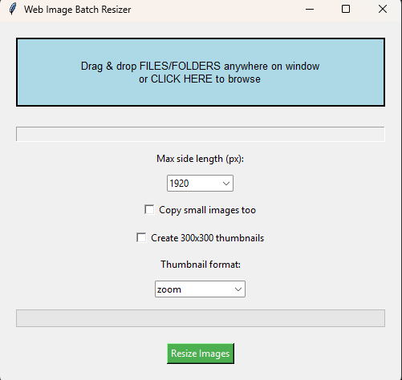

# ImageResizer - Batch Web Image Optimizer GUI

*note: I removed the pre-compiled .exe releases since Microsoft blocks unsigned executables without paid code signing—just run the Python script directly instead.



Drag files OR folders -> Pick size -> Optimized JPGs in /resized/

## Features
- Drag & Drop: Single files, multiple files, OR folders
- Smart Logic:
  - Files -> resize only those (/parent/resized/)
  - Folders -> full recursive batch
- Presets: 1920px hero, 1200px large, 800px thumbs
- Copy small images checkbox
- Progress + stats

## Quick Start

### Python (Windows / macOS / Linux)
```bash
pip install pillow tkinterdnd2
python image_resizer.py
```
Then drag JPGs or folders into the window -> pick your size -> click Resize!

## Examples
Drop single JPG:
`photos/art.jpg -> photos/resized/art.jpg`

Drop folder:
`photos/ -> photos/resized/all-your-images.jpg`

## Build Local EXE (Optional)
If you want to compile an executable for your own machine:
1. Download `image.ico` + `image_resizer.py` + `build_exe.bat`
2. Run `build_exe.bat` to generate `dist/ImageResizer.exe`

## Sample Results

Original           | Resized             | Savings
------------------|---------------------|--------
4000x3000 7.2MB   | 1920x1440 185KB    | 97%
3000x4000 5.8MB   | 1200x1600 112KB    | 98%

## Tech Stack
- Python 3.8+ / Tkinter (built-in GUI)
- Pillow - Image processing
- tkinterdnd2 - Drag & drop
- PyInstaller - Optional local EXE builds

## Credits
- Icon: Windows 11 Photos by FadeMind/W-ICO (Public Domain) https://github.com/FadeMind/W-ICO
- tkinterdnd2: https://github.com/pmgagne/tkinterdnd2
- Perplexity AI: Script generation
- Pillow: https://pillow.readthedocs.io

## License
MIT License - © 2026 pmonk.com (Austin, TX)

Free for all uses. No warranty—test on copies!
